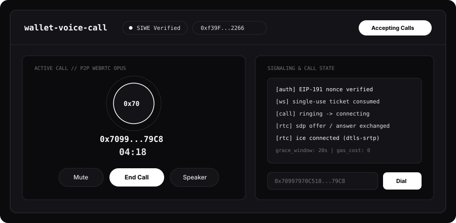

# wallet-voice-call


Why ask someone for their phone number when both guys already have EVM wallets. Sign a free message, type a `0x` address, and talk directly browser to browser.

When i wrote this WebRTC signaling state machine at 3am over adrak chai, only me and bhagwan knew how it worked. Now only bhagwan knows, and all the tests still pass.



## what is this

`wallet-voice-call` is a peer to peer voice calling app for EVM wallets.

* **Zero phone numbers, zero gas**: Sign in with MetaMask, Rabby, or built in test wallets using EIP 191 message signatures (`viem`).
* **Direct encrypted browser audio**: Audio flows peer to peer over WebRTC (`DTLS-SRTP`). Fastify WebSockets only pass SDP offers and ICE candidates.
* **WiFi drop survival**: If someone switches tabs or WiFi mid call, a 20 second grace window holds the call open and restarts ICE automatically. It is not a bug bhai, it is a surprise feature.
* **PostgreSQL call history**: Drizzle ORM stores nonces, HTTP only cookie sessions, call states, and missed calls cleanly.

## copy and run in 60 sec

Make sure Node 20+ and PostgreSQL are running on your machine.

```bash
git clone https://github.com/LevCodeLab/wallet-voice-call.git
cd wallet-voice-call
cp .env.example .env
npm install

# create postgres db and run tables migration
createdb wallet_voice_call
npm run db:migrate

# terminal 1: start fastify + websocket server on :3001
npm run dev

# terminal 2: start react 19 vite ui on :5173
npm run dev:client
```

Want to test a live call right now on one laptop:

1. Open Tab 1 at `http://localhost:5173` and pick **Alice (Hardhat Account #0)**.
2. Open Tab 2 (Incognito) at `http://localhost:5173`, pick **Bob (Hardhat Account #1)**, open **Me**, and turn on **Accepting calls**.
3. Paste Bob's `0x7099...79C8` address in Tab 1 and hit **Dial**.

Run typecheck and unit tests anytime (works even without Postgres running):

```bash
npx tsc --noEmit
npm test
```

## where to edit code

| File | What to change here |
| :--- | :--- |
| `src/modules/auth/verifiers/evm.verifier.ts` | EVM wallet signature check and domain binding |
| `src/modules/auth/auth.service.ts` | Nonce expiry, cookie session TTL, and single use WS tickets |
| `src/modules/calling/calling.service.ts` | 30s ringing timeout, busy checks, and 20s WiFi reconnect timer |
| `src/modules/realtime/realtime.routes.ts` | WebSocket `/ws` hub for SDP offers, answers, and ICE relay |
| `src/db/schema/` | Drizzle PostgreSQL tables for users, sessions, and call history |
| `client/src/services/webrtc.service.ts` | Browser mic capture, `RTCPeerConnection`, and ICE restart logic |
| `client/src/App.tsx` | Main React 19 calling UI and modal flow |
| `client/src/styles/design-tokens.css` | Monochrome dark obsidian theme tokens |

## license

MIT License. Clone it, break it, ship it. See [LICENSE](./LICENSE).
